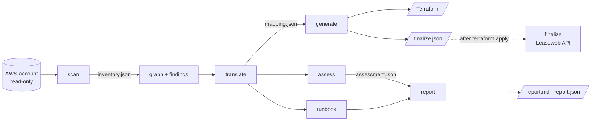

<div align="center">


# Sovereign Shift

**Scan a ClickOps AWS account. Get a Leaseweb migration plan.**

Terraform, a dependency graph, a data runbook and a scored report: security, risk, performance, scaling and cost.
Read-only. Deterministic. AI only where rules can't reach.

[](https://github.com/FranciscoJanuarioSilva/sovereign-shift/actions/workflows/assessment.yml)
[](LICENSE)
[](pyproject.toml)
[](#what-we-checked)

[Quick start](#quick-start) · [What you get](#what-you-get) · [How it works](#how-it-works) · [Sources](#sources) · [Docs](#documentation) · [Limits](#limits)

</div>

---

## The problem

Customers who already use Terraform are easy to move to a European cloud. Customers who built their AWS account **by clicking in the console** are not: nobody has the full picture of what exists or how it is connected. Existing tools turn that into *AWS* Terraform, which keeps you on AWS.

Sovereign Shift reads the account with read-only credentials, rebuilds the picture, and produces what a team needs to move to [Leaseweb](https://www.leaseweb.com), a European provider.

> Built at **Hackathon Portugal 2026** (Leaseweb × Velv, "InfraHack: AI for Cloud Infrastructure").

## What you get

| | |
|---|---|
| **Leaseweb Terraform** | for the `leaseweb/leaseweb` provider, validated with `terraform validate`, plus the Leaseweb API calls the provider can't make yet (security groups, load balancer targets) |
| **Dependency graph** | including the links nobody wrote down, like which servers can reach the database |
| **Security posture** | scored per area, today and after the move, plus what is reachable from the internet before and after |
| **Risk assessment** | likelihood × impact register, what the migration fixes and what it adds, a readiness verdict |
| **Performance and scaling** | capacity before and after, single points of failure, the next size up with its real price, a scale-out recipe, Leaseweb's hard limits |
| **Cost comparison** | real list prices on both sides: the AWS Pricing API for the scanned region, a committed Leaseweb API snapshot (no token needed) |
| **Data runbook** | `pg_dump`, `rclone`, `rsync` steps, personalised by AI, with commands that only come from vetted templates |
| **Report** | `report.md` and `report.json`, with an executive summary on top |

### What a report says

From the sample store in [`testdata/clickops_inventory.json`](testdata/clickops_inventory.json) (2 web servers, a load balancer, PostgreSQL, a bucket):

| | Today on AWS | After moving to Leaseweb |
|---|---|---|
| Security posture | **D** (41/100) | **C** (69/100) |
| Highest risk | critical | high |
| Compute cost | 162.80 EUR/month | 104.52 EUR/month (**−36%**) |

Readiness: **ready with conditions** (the data has to be copied, and the database becomes self-managed). The cost is compute only, see [Limits](#limits).

## How it works



Every step reads the previous step's JSON ([contracts](docs/contracts.md)), so any step can be rerun on its own.

**Deterministic first.** Rules and templates produce the Terraform, the firewall rules, the prices and every score. **AI** (Mistral through OpenRouter, pinned to Mistral with data collection denied) only:
- suggests an open-source replacement for services Leaseweb has no equivalent for,
- chooses and orders runbook steps from the allowed templates,
- reviews the firewall translation and writes short narratives around scores that are already computed.

It never writes Terraform, firewall rules or shell commands, never changes a score, and every suggestion is marked `ai-suggested`. `--no-ai` runs the whole pipeline offline. An assessment costs about 0.0002 USD in AI calls, and nothing on a rerun (answers are cached).

## Quick start

Python 3.11 or later. Terraform is only needed to validate or apply the output.

```bash
git clone https://github.com/FranciscoJanuarioSilva/sovereign-shift.git
cd sovereign-shift
python3 -m venv .venv && source .venv/bin/activate
pip install -e '.[test]'

# offline, no keys: the sample store
sovereign-shift all --from-snapshot testdata/clickops_inventory.json --no-ai --out out/store

# check the generated Terraform (validate needs no Leaseweb token)
terraform -chdir=out/store/terraform init && terraform -chdir=out/store/terraform validate
```

Open `out/store/report.md` and `out/store/graph.html`.

### On your own account

```bash
# read-only AWS profile (policy: docs/iam-policy.json), AI settings in .env (copy .env.example)
sovereign-shift all --profile <read-only-profile> --region eu-north-1 --out out/live
```

Pick another destination with `--target-region` (Leaseweb Amsterdam by default). Share only `out/live/public/`: the files there have the account id masked and `inventory.json` is never copied.

### The web app

```bash
.venv/bin/python frontend/serve.py --port 8001
```

Open <http://127.0.0.1:8001>, paste a **read-only** key and press **Generate report**, or open <http://127.0.0.1:8001/#demo> for the demo shop. Keys stay inside the local server for read-only calls: they are never saved, logged or sent to the AI, and a key that could change the account is refused. The destination can be Amsterdam, Frankfurt or the region closest to the source, and the **File** tab takes any inventory JSON.

### On GitHub

**Actions → Run migration assessment → Run workflow**, with a source:

| Source | Needs |
|---|---|
| `demo` | nothing: the sample store |
| `azure-demo` | nothing: the sample Azure subscription |
| `aws`, `gcp`, `cloudflare` | read-only credentials as repository secrets, see [usage](docs/usage.md#github-actions) |

The run validates the Terraform and uploads the masked files as a 3-day artifact. Live results are only shared when you tick "publish live results".

## Sources

| Source | Status |
|---|---|
| **AWS** | the main source. Run against a real account with a read-only key |
| **Azure** | [mapped and tested](docs/azure.md) with an SDK-shaped sample and the real SDK's own model classes. **Not run against a live subscription** |
| **Google Cloud** | [mapped and tested](docs/gcp.md) by replaying made-up REST responses. **Not run against a live project** |
| **Cloudflare** | Workers, bindings, D1, KV, R2, DNS. A [seeded demo Worker](examples/cloudflare-worker/README.md) runs locally |

The destination is always Leaseweb: Amsterdam, Frankfurt, London, the US, Canada, Singapore or Japan. Only Amsterdam and Frankfurt are billed in EUR and get a price; other regions show "unknown" instead of a guessed conversion.

## Trust and safety

- **Read-only by construction.** The AWS scanner makes `describe` and `list` calls. The web app refuses keys that can change the account. Product code never uses a write profile.
- **Nothing secret leaves the machine.** Keys, `user_data`, account ids and host IPs are redacted before any AI call. Public copies of the output mask the account id. A pre-commit hook blocks commits that contain credentials (`scripts/check-secrets.sh`).
- **AI with guardrails.** Answers are validated JSON. A runbook step that isn't in the template library is rejected, and so is an input that isn't from the inventory.
- **Honest numbers.** Anything that isn't measured says so: "not assessed", "unknown", starred estimates.

## What we checked

- `pytest`, 109 tests, covering the scanner mappings, translator rules, assessment scoring, report, packaging and the skills.
- `terraform validate` passes on the generated Terraform for every sample and for our live AWS demo account.
- A fresh install of the built wheel into an empty virtualenv runs an assessment from another folder, so a plain `pip install` works too.
- The Azure mapper is run through the installed SDK's own model classes, and every SDK call it makes is checked to exist.

## Repository

| Path | What |
|---|---|
| `sovereign_shift/scanner/` | read-only scanners: AWS, Azure, Google Cloud, Cloudflare |
| `sovereign_shift/graph/` | dependency graph, inferred links, security checks |
| `sovereign_shift/translator/` | source → Leaseweb rules, sizing, regions, prices |
| `sovereign_shift/assess/` | security posture, risk, performance, scaling (rules only) |
| `sovereign_shift/generator/`, `finalize/` | Terraform and cloud-init templates, post-apply Leaseweb API calls |
| `sovereign_shift/runbook/`, `runbook/templates/` | data migration steps and their allowed commands |
| `sovereign_shift/report/` | report, assessment sections, AI summaries |
| `sovereign_shift/ai/`, `prompts/` | LLM client, redaction, prompts |
| `frontend/` | the web app: React source in `web/`, build in `dist/`, local server `serve.py` |
| `skills/` | the **skill tree**: one `SKILL.md` per pipeline job, for AI agents |
| `data/`, `mappings/` | Leaseweb price snapshot, instance types, region and image maps |
| `examples/`, `testdata/` | demo inventories and samples |
| `docs/`, `tests/` | documentation and the test suite |

### Skill tree for AI agents

[`skills/`](skills/README.md) holds one `SKILL.md` per job (scan, translate, assess, generate, finalize, runbook, report). They are linked from `.claude/skills` so coding agents find them, and the assessment skills are the scoring rubrics our own agents use. A test keeps them in sync with the code.

## Documentation

| | |
|---|---|
| [Usage](docs/usage.md) | every command and option, prices, GitHub Actions |
| [Assessment sections](docs/assessment.md) | how security, risk, performance and scaling are scored, and their limits |
| [Cost assessment](docs/cost-assessment.md) | worked numbers with sources, including what AI costs per run |
| [Contracts](docs/contracts.md) | the JSON passed between steps |
| [Translator](docs/translator.md) | how each resource maps to Leaseweb |
| [Research](docs/research/README.md) | sourced facts on AWS, Leaseweb, regions and AI providers |
| [Plan](PLAN.md) and [rules for coding agents](AGENTS.md) | scope, decisions, conventions |

## Limits

- **Terraform rebuilds infrastructure, not data.** Disks, buckets and databases move with the runbook.
- **No managed database on Leaseweb:** RDS becomes PostgreSQL or MySQL on its own instance, so backups and patching become yours.
- **The cost total is compute only.** Storage, traffic, public IPs, load balancers, taxes and discounts aren't included. Tiny AWS instances map to Leaseweb's smallest size (2 vCPU), so they can cost more there.
- **Performance is capacity, not load.** Real utilisation isn't scanned yet.
- **Not run on Leaseweb yet:** `terraform apply` and a live `finalize` are untested against a real account. Whether Leaseweb's default allow-all security group can be detached is still open, so check the effective firewall rules after finalizing.
- **Azure and Google Cloud have no live run.** See the status table above.

## License

[Apache-2.0](LICENSE).
